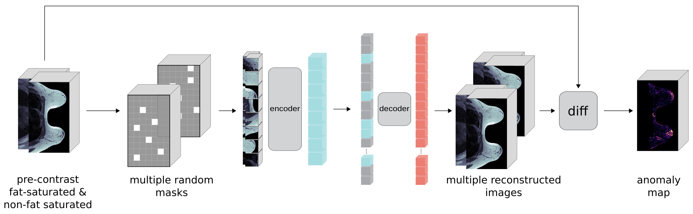

# 3D Masked Autoencoders

[](https://arxiv.org/abs/2303.05861)
[](./LICENSE.md)
[](./requirements.txt)

A from-scratch extension of [Masked Autoencoders (He et al., 2022)](https://github.com/facebookresearch/mae)
from 2D natural images to **(3D) volumetric, multi-channel data**. The
2D ViT patch embedding, masking, and sin-cos positional encoding of the
original MAE are reimplemented for 3D tensors, so the
encoder/decoder architecture can be pretrained self-supervised on a stack
of volumes (medical imaging, microscopy z-stacks, video-as-volume, or other
3D data) with a configurable patch size per axis and an
arbitrary number of input channels.

This repo includes both the general model
([`training/mae3d/`](./training/mae3d)) and a full worked example: pretraining
and evaluating it for anomaly detection in non-contrast breast MRI
([`utils/`](./utils), [`inference/`](./inference)), published at
MICCAI 2023.



## Using it on your own volumetric data

The model only assumes a `(N, C, H, W, D)` input tensor, nothing here is
specific to MRI:

```python
from training.mae3d.models_mae import MaskedAutoencoderViT_3D

model = MaskedAutoencoderViT_3D(
    img_size=(240, 168, 8),   # (H, W, D) of your volumes
    patch_size=(8, 8, 2),     # must evenly divide img_size, per axis
    in_chans=2,                # number of input channels/sequences
    embed_dim=768, depth=12, num_heads=12,
    decoder_embed_dim=384, decoder_depth=4, decoder_num_heads=16,
)

loss, pred, mask = model(volumes, mask_ratio=0.9)  # volumes: (N, C, H, W, D)
```

Swap in your own `torch.utils.data.Dataset` (see
[`training/sequence.py`](./training/sequence.py) for the pattern used
here) and reuse `train_one_epoch` from `engine_pretrain.py` for the
training loop, distributed setup, and checkpointing.

## Case study: non-contrast breast MRI anomaly detection

DCE-MRI (contrast-enhanced) is the clinical gold standard for breast tumor
localization but requires contrast agent injection and repeated
scans. As a concrete application of the model above, `mae_vit_base` is
pretrained on **non-contrast** MRI patches (2-channel: fat-saturated /
non-fat-saturated T1) from healthy tissue only; at test time,
reconstruction errors become an anomaly map, benchmarked against DCE
subtraction images.

* [`utils/`](./utils) — download the public
  [Duke-Breast-Cancer-MRI](https://www.cancerimagingarchive.net/) (TCIA)
  cohort, run breast-tissue segmentation, generate bounding boxes, extract
  patches into HDF5, and split train/val/test
* [`training/train.sh`](./training/train.sh) — pretrain/fine-tune using
  [`training/parameter/par.yml`](./training/parameter/par.yml), holding the parameters of our submission
* [`inference/`](./inference) — generate anomaly maps from a checkpoint
  (`mae_predict.py`) and build the DCE subtraction images they're
  evaluated against (`subtraction_images.py`)

Each folder has its own README with exact commands.

## Getting started

```bash
git clone git@github.com:LangDaniel/MAEMI.git
cd MAEMI
conda create -n mae python=3.9
conda activate mae
pip install -r requirements.txt
```

## Cite as

```bibtex
@inproceedings{lang2023multispectral,
    title={Multispectral 3d masked autoencoders for anomaly detection in non-contrast enhanced breast mri},
    author={Lang, Daniel M and Schwartz, Eli and Bercea, Cosmin I and Giryes, Raja and Schnabel, Julia A},
    booktitle={MICCAI Workshop on Cancer Prevention through Early Detection},
    pages={55--67},
    year={2023},
    organization={Springer}
}
```

## License

Apache License 2.0 (see [`LICENSE.md`](./LICENSE.md)), except for
subfolders carrying their own license — most notably
[`training/mae3d/`](./training/mae3d), which builds on Meta's original
[MAE implementation](https://github.com/facebookresearch/mae).
